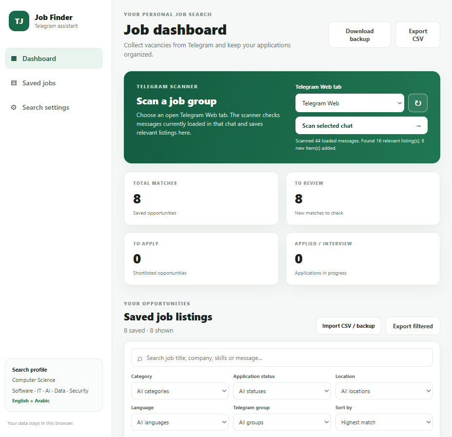
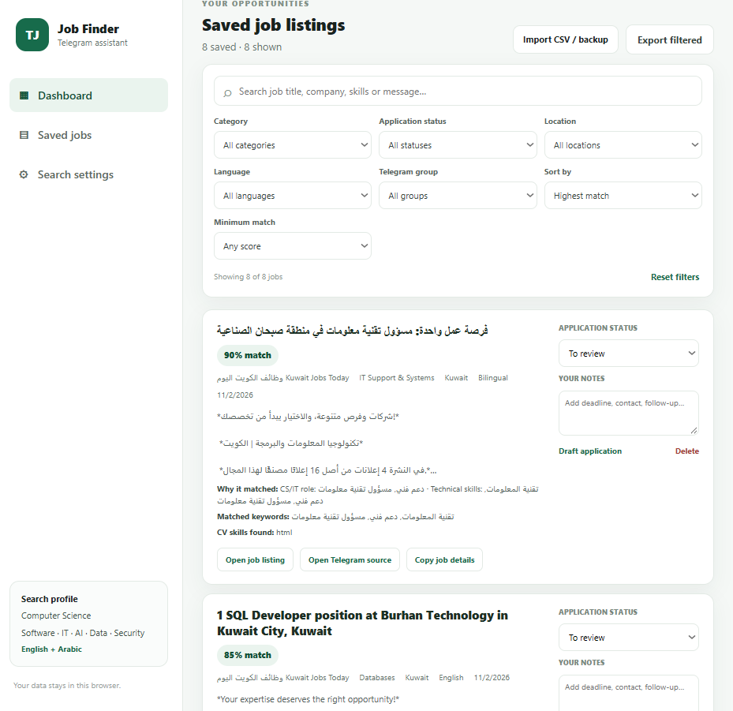
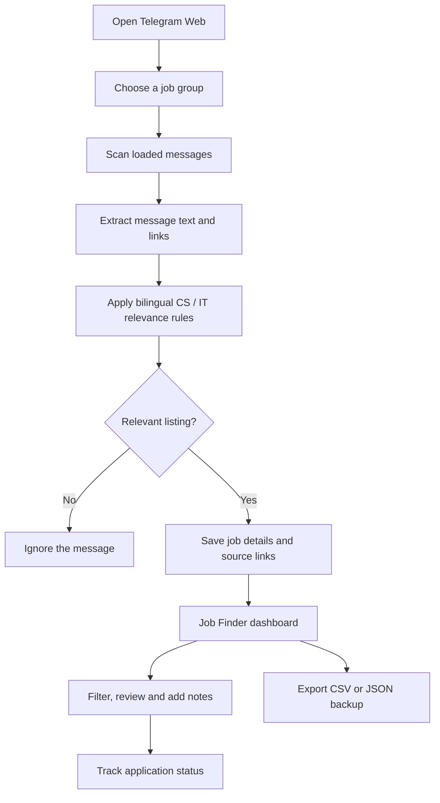

<div align="center">

# Telegram Job Finder

**A bilingual Chrome extension that turns busy Telegram job groups into an organized, searchable job tracker.**

[](https://developer.chrome.com/docs/extensions/develop/migrate/what-is-mv3)
[](https://developer.mozilla.org/en-US/docs/Web/JavaScript)
[](#bilingual-job-matching)
[](#privacy-and-data)

<br />

*Find relevant opportunities. Keep the original source. Track every application.*

</div>

---

## Overview

Telegram Job Finder is a personal job-search assistant built as a **Chrome Manifest V3 extension**. It scans messages currently loaded in a selected Telegram Web chat, identifies posts that appear relevant to Computer Science and technology roles, and collects them in a dedicated dashboard.

The project was created to reduce the time spent manually searching busy job-vacancy groups. It supports English and Arabic job content and keeps the **Telegram source link** separate from the **external job-listing link** shared in a post.

> **Important:** Matching is performed locally using configurable rules and keywords. It is not a hosted AI service, and its match score is a heuristic relevance estimate—not a guarantee that a job is suitable or that an application will be successful.

## Screenshots

### Dashboard and Telegram scanner



### Saved opportunities and application tracking



## Key features

- **Telegram Web scanning** — scan the currently loaded messages in a selected Telegram Web tab.
- **Bilingual job matching** — English and Arabic keywords for Computer Science, software development, IT, data, AI, machine learning, QA/testing and cybersecurity.
- **Relevance filters** — generic words such as *internship*, *remote*, *graduate* and *hiring* do not qualify a post by themselves. Unrelated role titles can be excluded and the keyword profile can be customized.
- **Separate source and application links** — open the original Telegram chat/message separately from the external job page linked in the listing.
- **One record per listing** — when a message contains multiple vacancy links, linked opportunities can be tracked separately.
- **Job dashboard** — search and filter saved opportunities by category, application status, location, language, Telegram group and minimum match score.
- **Sorting** — sort by relevance score, date found or job title.
- **Application tracking** — track a job as To review, To apply, Applied, Interview, Offer or Rejected.
- **Personal notes** — add follow-up notes, deadlines and contact details to each opportunity.
- **Application draft helper** — prepare a draft message to review and personalize before sending.
- **CSV export** — export all jobs or the currently filtered results, with separate Telegram and job-listing URL columns.
- **JSON backup and restore** — preserve saved jobs, statuses, notes and search settings.
- **Local-first storage** — saved job data and settings are stored in Chrome extension storage; the extension does not send chat contents to a remote AI service.

## How it works



## Technology stack

| Technology | Purpose |
|---|---|
| JavaScript (ES6+) | Message parsing, matching, dashboard logic and extension behavior |
| HTML5 | Dashboard structure and controls |
| CSS3 | Responsive dashboard layout and visual styling |
| Chrome Extensions API | Manifest V3, tabs, scripting, background service worker and local storage |
| Telegram Web DOM | Reads the messages rendered in the selected Telegram Web chat |

No framework, build system, backend server or API key is required for the current version.

## Getting started

### Requirements

- Google Chrome or a Chromium-based browser that supports Manifest V3.
- Access to [Telegram Web](https://web.telegram.org/) and membership in the groups you want to scan.
- Windows, macOS or Linux.

### Install from source

1. Download this repository using **Code → Download ZIP**, then extract the ZIP. Alternatively, clone the repository using Git.
2. Open Chrome and navigate to `chrome://extensions`.
3. Enable **Developer mode**.
4. Select **Load unpacked**.
5. Choose the project folder that contains `manifest.json` directly.
6. Open or refresh [Telegram Web](https://web.telegram.org/), sign in, and open a job group.
7. Click the Telegram Job Finder extension icon. The dashboard opens in a new tab.
8. In the dashboard, select the open Telegram Web tab and choose **Scan selected chat**.
9. To collect opportunities from another group, navigate to that group in Telegram Web and scan again. Results from scanned groups are collected in the same dashboard.

### Update the extension

After pulling or downloading a newer version, open `chrome://extensions` and click the reload icon on the Telegram Job Finder extension. If you downloaded the source into a different folder, use **Remove** and then **Load unpacked** to select the new folder. Export a JSON backup before replacing an installation if you want to preserve dashboard data.

## Using the dashboard

1. **Scan:** choose an open Telegram Web tab and scan the selected chat.
2. **Review:** inspect the listing title, match score, category, language, location and matched terms.
3. **Verify:** use **Open job listing** to visit the external vacancy page, and **Open Telegram source** to return to the original Telegram chat.
4. **Organize:** set an application status and add notes to each saved opportunity.
5. **Find:** search or filter by category, status, location, language, group and match score.
6. **Export:** use CSV for spreadsheet workflows or JSON backup to preserve the complete dashboard state.

### Application statuses

| Status | Suggested use |
|---|---|
| To review | Newly found opportunity that still needs checking |
| To apply | Relevant opportunity shortlisted for an application |
| Applied | Application submitted |
| Interview | Interview process started |
| Offer | Offer received |
| Rejected | Not proceeding or application unsuccessful |

## Bilingual job matching

The default search profile is focused on a Computer Science graduate and includes role and skill terms related to:

- Software engineering and development
- Frontend, backend and full-stack web development
- Java, JavaScript, Python, C/C++, React and Node.js
- IT support, systems and application support
- Databases, SQL and data analysis
- Artificial intelligence, machine learning and deep learning
- Cybersecurity and information security
- Quality assurance and software testing

Arabic equivalents are included for common role names and vacancy terminology. Search keywords, exclusions and the minimum match threshold can be changed in **Search settings**.

The matching rules are designed to avoid treating broad words such as *internship* or *remote* as sufficient evidence of relevance. A listing needs stronger CS/IT role or technical-skill context. Exclusion rules can filter clearly unrelated role titles, but automated classification can still make mistakes; review the original listing before applying.

## Data format and backups

CSV exports include fields such as job title, category, location, language, Telegram group, match score, matched keywords, match explanation, CV skill overlap, application status, notes, original message, Telegram chat URL, external job-listing URL and saved timestamp.

JSON backups preserve the dashboard's saved jobs, notes, application statuses and settings. Store backups somewhere private because they may contain copied Telegram message text and personal job-search notes.

## Privacy and permissions

Telegram Job Finder is designed as a local-first personal utility:

- The extension reads message content rendered in Telegram Web pages that you open and choose to scan.
- Saved jobs and settings are kept in Chrome's extension storage on your browser profile.
- The current implementation does not call an external AI API or upload chat messages to a project server.
- CSV and JSON files are created only when you choose to export or back up your data.

The extension requests these permissions:

| Permission | Why it is used |
|---|---|
| `storage` | Save jobs, settings, statuses and notes locally in Chrome |
| `tabs` | Find open Telegram Web tabs and let you select one to scan |
| `scripting` | Ensure the scanner script is available in the selected Telegram tab |
| `https://web.telegram.org/*` host access | Run the content script on Telegram Web pages |

Only install the extension from source you trust. Avoid exporting or committing real Telegram chat data, CSV exports or JSON backups to a public repository.

## Current limitations

- The scanner can only inspect messages that Telegram Web has loaded in the selected chat. It does not crawl all historical messages or every group automatically.
- To scan multiple groups, open each group in Telegram Web and scan it; the dashboard combines the opportunities collected from those scans.
- Automatic watching of open Telegram Web pages can be enabled in Search settings, but it depends on the page being open and rendering new messages.
- Match scores, categories, language, location and CV-skill overlap are rule-based estimates. They are not an AI assessment or a verification of eligibility.
- External job pages are not fetched or independently verified. The extension extracts the link included in the Telegram post.
- The extension does not submit applications or send a CV automatically. Review every vacancy and draft before contacting an employer.
- This project is not affiliated with, endorsed by or sponsored by Telegram.

## Project structure

```text
telegram-job-finder/
├── manifest.json       # Chrome Manifest V3 configuration
├── background.js       # Opens and focuses the dashboard
├── content.js          # Reads Telegram Web messages and applies matching rules
├── dashboard.html      # Dashboard layout
├── dashboard.css       # Dashboard styling
├── dashboard.js        # Filters, saved jobs, tracking, import and export
├── docs/
│   └── screenshots/    # Product screenshots used in this README
├── README.md
└── .gitignore
```

## Development and validation

The extension uses plain JavaScript and does not require a package installation or build step. To check JavaScript syntax locally, install Node.js and run these commands from the project folder:

```bash
node --check background.js
node --check content.js
node --check dashboard.js
```

Then reload the unpacked extension from `chrome://extensions` and test it with a Telegram Web chat containing messages you are permitted to access.

## Roadmap

- Improve Arabic job-title extraction and relevance evaluation.
- Add stronger duplicate detection across groups and repeated vacancy posts.
- Improve job description parsing and experience-level detection.
- Add automated tests using representative Arabic and English message examples.
- Consider optional AI-assisted analysis as an opt-in feature with clear privacy controls.

## Author

**Nadeen Menacy** — [GitHub profile](https://github.com/nadeen-menacy)

Built as a portfolio project to explore browser extensions, DOM parsing, bilingual text matching, local data management and job-search workflow design.

---

<div align="center">

**Telegram Job Finder · Version 2.0.0**

</div>
